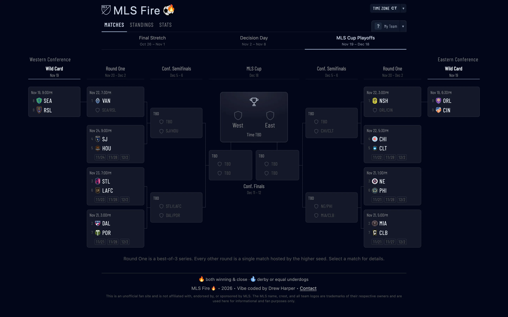
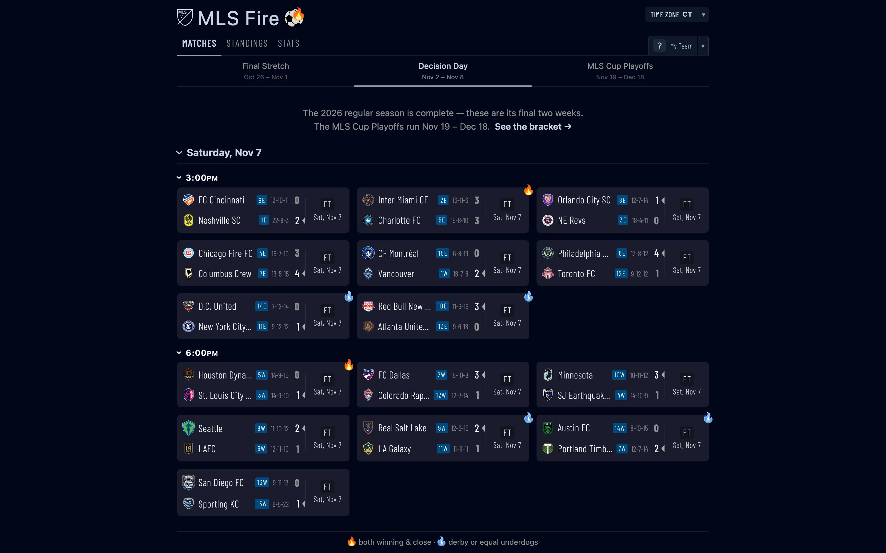
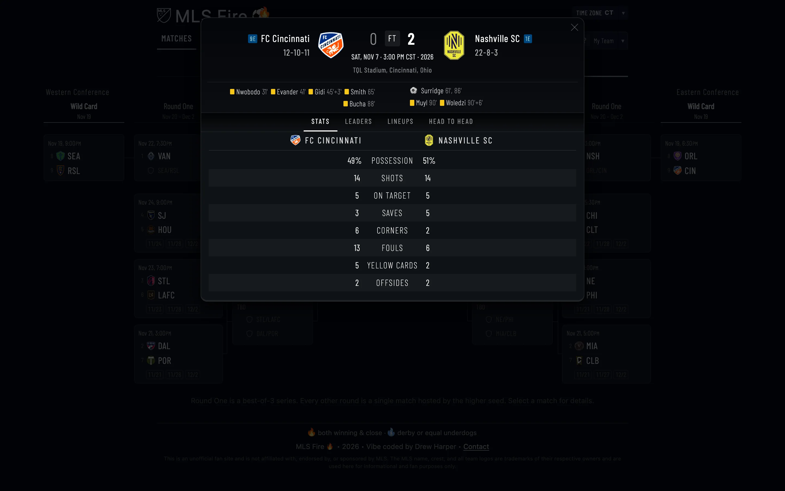
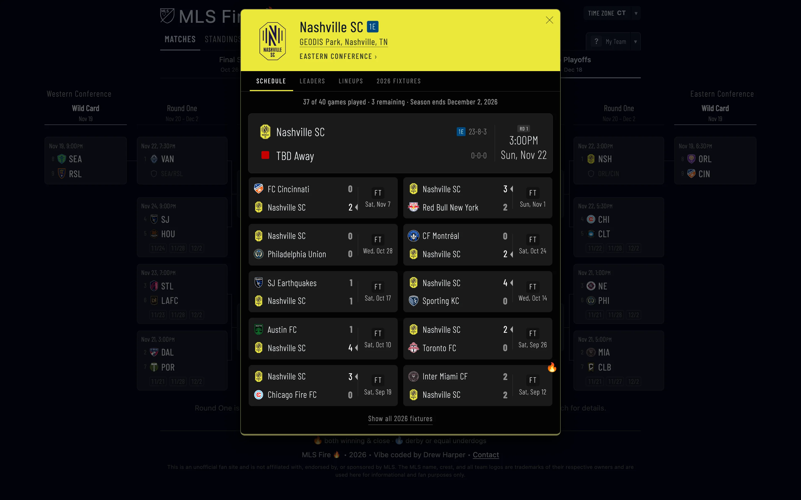
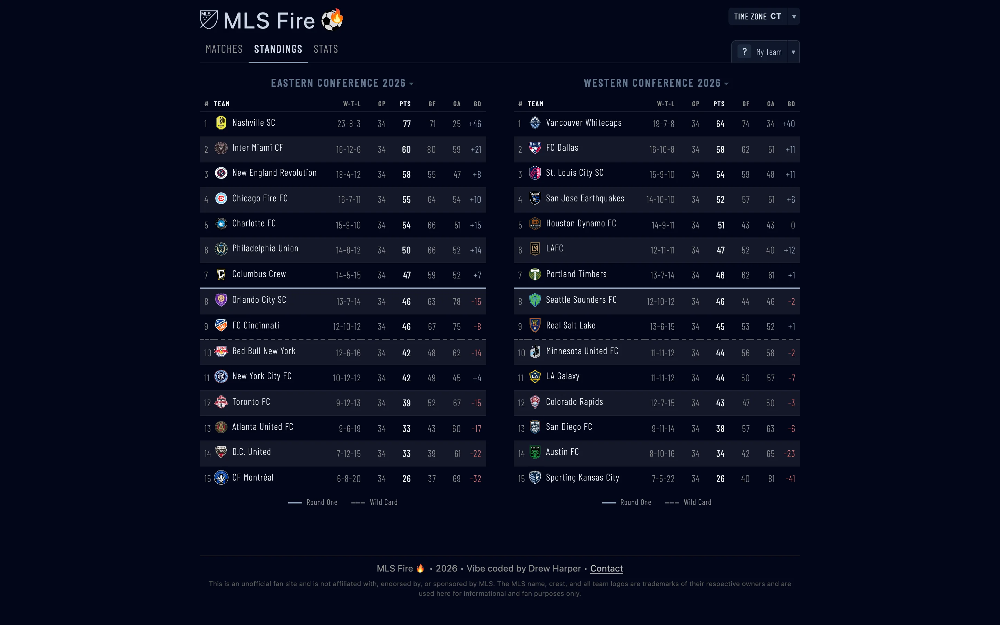
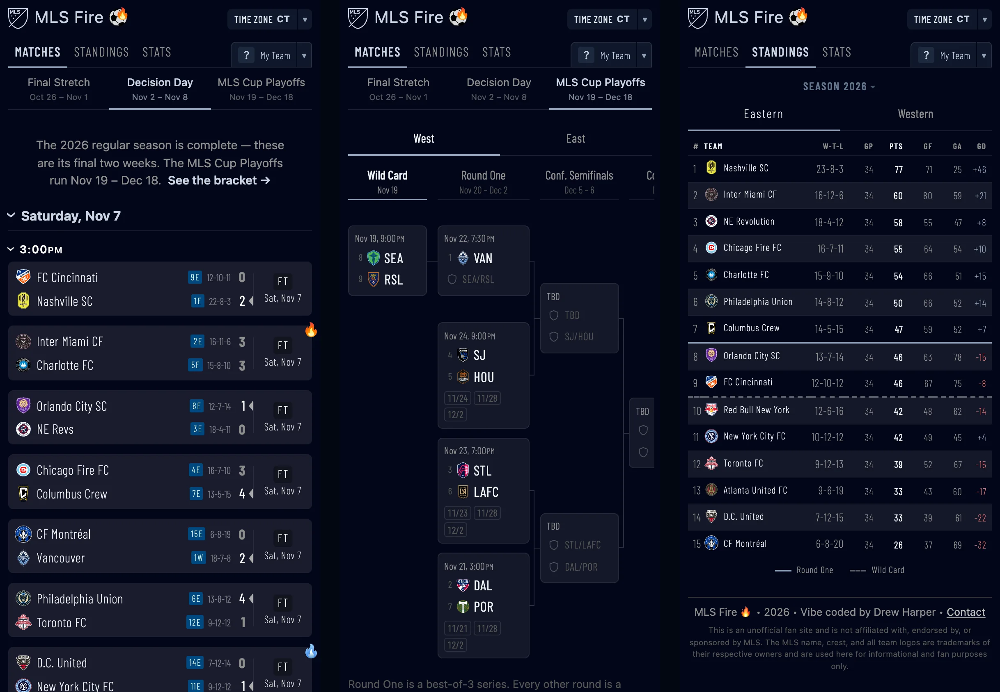

# ⚽ MLS Fire

Live MLS scores, standings, stats and the MLS Cup Playoffs bracket — fast, mobile-friendly, and themed in your club's colours. Built with **Nuxt 4** and deployed on **Netlify**.

🔗 **Live:** [mlsfire.net](https://mlsfire.net)



| Scores                                           | Match detail                                             |
| ------------------------------------------------ | -------------------------------------------------------- |
|      |  |
| **Team detail**                                  | **Standings**                                            |
|  |  |



---

## Features

**Scores**

- Every match of the week, grouped by day and kickoff time, with past days collapsing as the week moves on.
- Live clock, halftime and full-time states. Polls every 30 seconds while a game is live, and refreshes when you come back to the tab.
- Fire badges flag the matches worth watching: 🔥 when both teams are winning and closely matched, a blue flame for a derby or two evenly matched underdogs.
- Conference-position badges (`3E`, `7W`) on every team.
- Leagues Cup fixtures appear alongside MLS games.
- Any time zone, picked from the header.

**MLS Cup Playoffs**

- Full mirrored bracket — Wild Card, best-of-3 Round One, Conference Semifinals and Finals feeding into MLS Cup.
- Live scores in the bracket; matchups open a preview even before ESPN schedules the game.
- A champion banner once MLS Cup is decided.
- One conference at a time on narrow screens.

**Standings & stats**

- Eastern and Western Conference tables with playoff cut lines.
- A season picker for past years' final standings.
- League leaders for goals, assists, accurate passes, saves and cards.

**Match & team detail**

- Match modal: stats, player leaders, lineups, head-to-head history, goals and cards.
- Team modal: recent results and next game, season leaders, roster with nationalities, and the full fixture list.
- Click any team anywhere to open its modal; back/forward navigation works between modals.

**Your club**

- Pick **My Team** and the whole site re-themes itself in that club's colours.

**Between seasons**

- Once the regular season ends, the last two weeks stay up ("Final Stretch" and "Decision Day") alongside the bracket until the next season starts — frozen to JSON, so they no longer depend on the API.

---

## Tech stack

| Layer           | Technology                                                                 |
| --------------- | -------------------------------------------------------------------------- |
| Framework       | [Nuxt 4](https://nuxt.com) (Vue 3, `<script setup lang="ts">`)             |
| Styling         | Scoped component CSS on a small reset — no CSS framework                   |
| Colour          | `oklab()` / `oklch()` throughout                                           |
| Team palettes   | [culori](https://culorijs.org) — per-club palettes with contrast checks    |
| Server routes   | Nuxt server API (`server/api/`) → Netlify Functions                        |
| Data            | ESPN's public (unofficial) API, plus frozen JSON for finished seasons      |
| Analytics       | Self-hosted page views in [Netlify Blobs](https://docs.netlify.com/blobs/) |
| Deployment      | [Netlify](https://netlify.com) (Nitro `netlify` preset)                    |
| Package manager | [pnpm](https://pnpm.io)                                                    |

---

## Project structure

```
app/
├── assets/css/          reset, global variables, scrollbar
├── components/
│   ├── GameDetail/      match modal + Stats / Leaders / Lineups / H2H tabs
│   ├── TeamDetail/      team modal + Schedule / Leaders / Lineups / Fixtures tabs
│   ├── Playoffs/        bracket, tie and MLS Cup cards
│   ├── ScoresSection.vue, StandingsTable.vue, StatsSection.vue, …
├── composables/         data fetching + typed state (useScores, useStandings, usePlayoffs, …)
├── constants/mls.ts     season dates and flags — the one place to update each season
└── pages/               index (the app), admin (analytics), preview (dev tool)

server/
├── api/                 scores, standings, stats, playoffs, match-detail, team-detail, schedule, …
├── assets/              frozen standings and match weeks for finished seasons
├── middleware/          analytics + admin auth
└── utils/               bracket builder, season records, matchup previews, …

netlify/functions/       scheduled score-API health check
scripts/                 data checks and season archiving
```

---

## Getting started

Requires [Node.js](https://nodejs.org) 22 and [pnpm](https://pnpm.io) 10.

```bash
git clone https://github.com/midlantica/mlsfire-net.git
cd mlsfire-net
pnpm install
pnpm dev          # http://localhost:3000
```

| Command                         | What it does                                                                |
| ------------------------------- | --------------------------------------------------------------------------- |
| `pnpm dev`                      | Dev server on port 3000                                                     |
| `pnpm build` / `pnpm preview`   | Production build and local preview                                          |
| `pnpm format`                   | Prettier                                                                    |
| `pnpm check:data`               | Compares team, venue and season data against ESPN; smoke-tests the live API |
| `pnpm archive:standings <year>` | Freezes a finished season's final standings                                 |
| `pnpm archive:week <monday>`    | Freezes a finished week of matches (needs `pnpm dev` running)               |

### Season changeover

Season dates live in `app/constants/mls.ts`. After Decision Day, archive the final standings and the last two weeks; when the next schedule is published, set the next season's dates; in opening week, bump `SEASON_YEAR`. The full checklist is in [CLAUDE.md](CLAUDE.md#season-changeover-checklist).

---

## Deployment

Netlify builds with the Nitro `netlify` preset (`netlify.toml` is included); every `server/api/` route becomes a Netlify Function. Push to the connected repo to deploy.

### Environment variables

Set these in **Netlify → Project configuration → Environment variables**. `.env.example` lists the same names for local setup. Never commit their values.

| Variable                | Used for                                                     |
| ----------------------- | ------------------------------------------------------------ |
| `ADMIN_PASSWORD`        | HTTP Basic Auth for the `/admin` analytics dashboard         |
| `ANALYTICS_EXCLUDE_IPS` | Optional — comma-separated IPs left out of analytics (yours) |
| `SITE_URL`              | Origin the health check calls, e.g. `https://mlsfire.net`    |
| `RESEND_API_KEY`        | Email alerts via [Resend](https://resend.com)                |
| `ALERT_EMAIL_FROM`      | Sender — must use a domain verified in Resend                |
| `ALERT_EMAIL_TO`        | Where alerts go                                              |

### Score API monitoring

`netlify/functions/score-health.ts` is a scheduled function that runs every 10 minutes. It calls the deployed `/api/scores?week=this` and opens an incident only when the response is unavailable, malformed or reports an upstream failure — an empty week during a break is healthy.

- An alert email goes out on the first failure, then at most every six hours while the incident stays open.
- A recovery email follows once the endpoint is healthy again.
- Every run logs a status line to **Netlify → Logs → Functions**, with a `NEXT STEP` when something fails.

---

## Data source

Match data comes from ESPN's public (unofficial) API — no key required. The browser never calls ESPN directly: the routes in `server/api/` proxy, cache and normalise the responses into typed shapes for the composables. Finished seasons are served from frozen JSON in `server/assets/`.

---

## Disclaimer

MLS Fire is an unofficial fan site. It is not affiliated with, endorsed by, or sponsored by Major League Soccer. The MLS name, crest and team logos are trademarks of their respective owners.

## License

[MIT](LICENSE) © 2026 Drew Harper. Team names and logos are not covered — see the disclaimer above.
